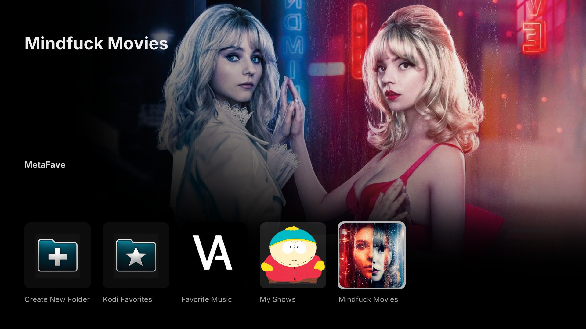
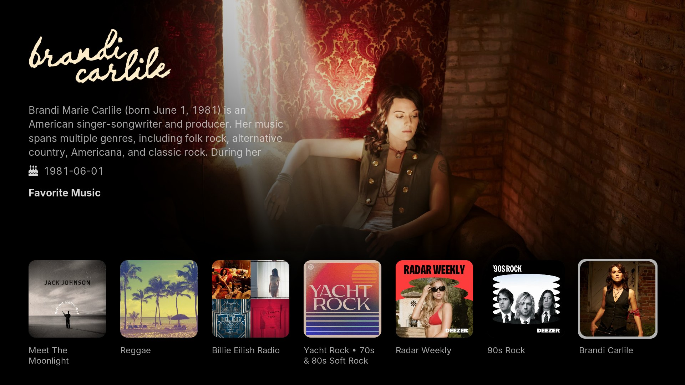
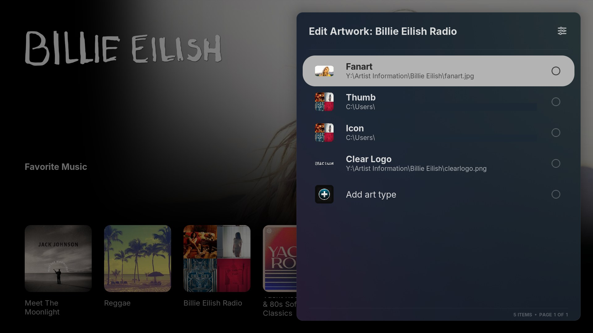
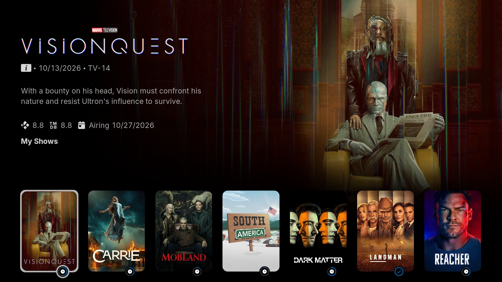

# MetaFave

Organize Kodi favorites and shortcuts into your own folders and use them as
widget sources. Preserve artwork, edit destinations, and build collections
that you control.

Version: 1.0.2  
Authors: SEA6ULL / Claude / GPT  
License: GPL-3.0-only (see LICENSE.txt)  
Requires Kodi 21 (Omega) or newer.

*Your folders with their own covers: each folder shows the cover chosen for it,
and the highlighted folder's fanart fills the background.*

## Adding and organizing items

Open **Add to MetaFave** from an item's context menu. Choose an existing folder
or create one with a suggested name already filled in, then confirm or edit
the prefilled item name.

Saved items keep the artwork and metadata of their source, so a folder
looks as rich as the add-on or library it came from.

*A music folder with artist artwork and details: albums, playlists and artists
from different sources in one folder, each with its clear logo, fanart and
biography.*

Inside MetaFave you can create nested folders, copy or move items and folder
contents, change their order, delete entries, and edit metadata, properties,
artwork and destinations. **Replace Target of Existing Item** in the add dialog
repairs a shortcut while keeping its presentation. Deleting an entry affects
only the MetaFave shortcut.

**Kodi Favorites** displays Kodi's built-in favorites as a read-only list.
**Go to Source** helps you locate the original entry so it can be added with
its full artwork and metadata.

## Editing artwork

**Edit Artwork** supports custom art, with previews and Kodi's artwork picker.
Each art type is listed with its current image. Choose one to replace it, or use
**Add art type** for a type that isn't set yet.

*Edit Artwork for a saved item: every art type with a preview of its current
image.*

Folder covers can come from the folder's own contents. In a folder's **Edit
Artwork**, choose a cover type, then **From Items in This Folder** to pick from
the images of its items and subfolders. Or open the context menu on an item or
subfolder and choose **Use as Artwork for** *(folder name)*, then tick the cover types
to take from it. Images are copied, so the cover stays if the entry is later
moved or deleted.

## Copying lists

On an external list/folder, choose **Add to MetaFave > Copy list contents**.
The same option is available on saved external-folder shortcuts inside MetaFave.
Choose a destination or create a new folder with the source name prefilled.
The resulting items are independent local copies that you can edit freely.

When a recognizable next-page link is present, choose **Copy this page** or
**Copy this and following pages**. Other paging mechanisms may require copying
pages separately. Copying starts at the selected page. Subfolders, including TV
shows, remain shortcuts rather than being recursively expanded.

The source's order, exposed artwork, metadata, media IDs and playback targets
are preserved. Source add-ons still handle opening and playback. MetaFave does
not synchronize with or modify the original list. Remote artwork URLs remain
URLs; images are not downloaded for permanent offline storage.

Duplicate skipping defaults on and matches reliable media IDs or exact launch
targets, never labels. Turn it off in settings when intentionally duplicating
items. Canceling or encountering an unreadable later page saves no partial
copy. Imports are bounded at 500 pages or 100,000 staged entries.

## Folder pagination and widgets

Pagination defaults on with **20 items per page**. Change the page size in 
settings. This display limit never limits how many items are saved.
Items and subfolders share one order, with Previous/Next page entries as needed.

A folder's **Folder pagination** menu can inherit the global settings, set its
own amount, or **Show all items**. The separate **Show all items** context-menu
action opens a complete view once without changing the saved preference.

Use a folder directly as a widget source:

    plugin://plugin.program.metafave/?folder=<id>

For an unpaged widget source:

    plugin://plugin.program.metafave/?folder=<id>&all=1

Alternatively, set that folder's pagination override to Show all items and let
the skin apply its own widget limit. **Content Type** controls the views the skin
offers; Automatic follows the folder's contents. Widget refresh and navigation
behavior depend on the skin.

## Watched and progress indicators

**Show library watched/progress indicators** defaults on. Verified Kodi-library
status takes priority, including an unwatched result.

*A TV show folder with watched and progress indicators: posters, clear logos and
episode details come from the saved items. Each badge marks a show as in
progress or watched.*

**Show MDBList watched and progress indicators** is optional and defaults off.
Enable it and enter your personal MDBList API key in settings. The separate
MDBList Kodi add-on is not required. MetaFave reads watched history, paused
progress and show completion/counts; it does not report playback or change
tracking data. The application you play through must report that activity.

Matching requires reliable movie/show IDs, or explicitly scoped episode IDs or
parent-show IDs with season and episode numbers. Source add-ons do not always
expose these consistently. Use **Edit Item > Metadata** to inspect or add IDs.
Parent-show episode matching uses TMDb numbering. Unknown results stay unmarked.

The shared cache refreshes in the background on eligible browsing, at most once
per 15 minutes when successful. After initial setup, allow a few seconds and
reopen the folder or refresh its widget. Indicator appearance depends on the
skin. Failures delay retries; data older than 24 hours is hidden.
